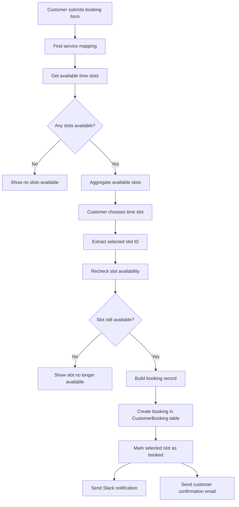

Project: Service Booking Workflow

**
Purpose:
Customers select a service and an available appointment slot.

Connected systems:

- n8n Forms
- n8n Data Tables
- SMTP email
- Slack Incoming Webhook

Success path:

1. Customer submits details.
2. Workflow maps the service name to its internal ID.
3. Available slots are retrieved.
4. Customer chooses a slot.
5. Slot availability is checked again.
6. Booking record is created.
7. Slot status changes from available to booked.
8. Customer receives an email.
9. Team receives a Slack notification.

Failure cases:

- No slots are available when the customer starts booking.
- Selected slot becomes unavailable before final submission.

Required Data Tables:
Services_mapping:
serviceId, serviceName, isActive

TimeSlots:
slotId, serviceId, date, startTime, endTime, status

CustomerBooking:
firstName, lastName, email, phone, address, slotId, serviceId,
appointmentDate, startTime, endTime, bookingStatus, bookedAt

# Service Booking Workflow Map

